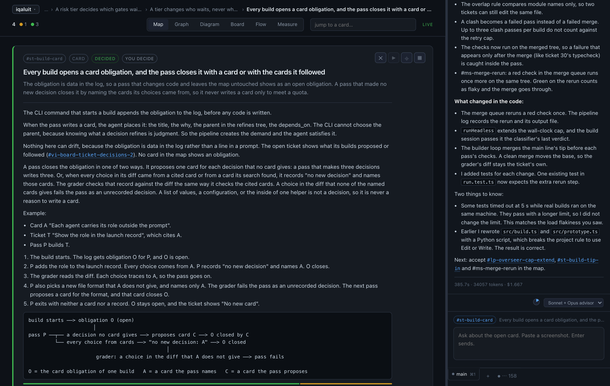
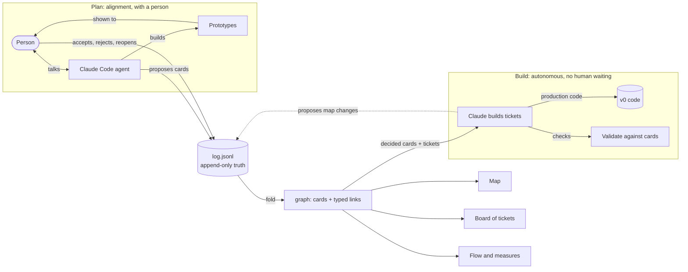
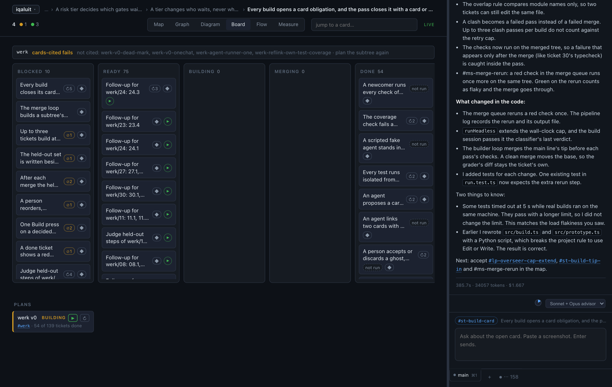
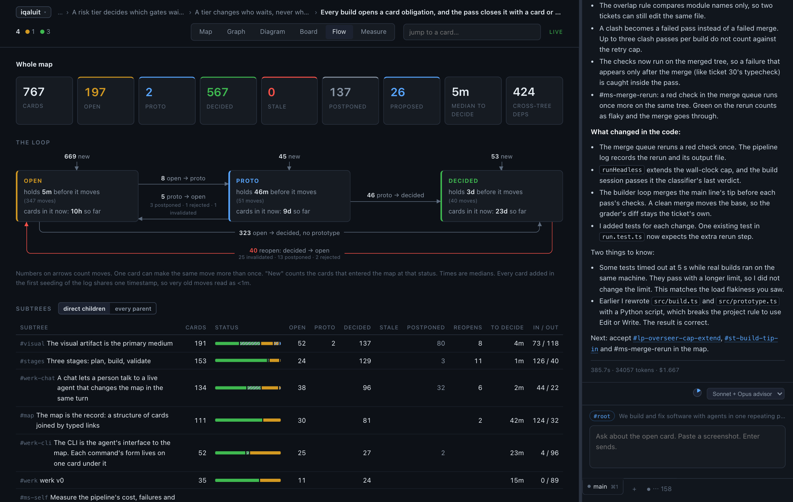
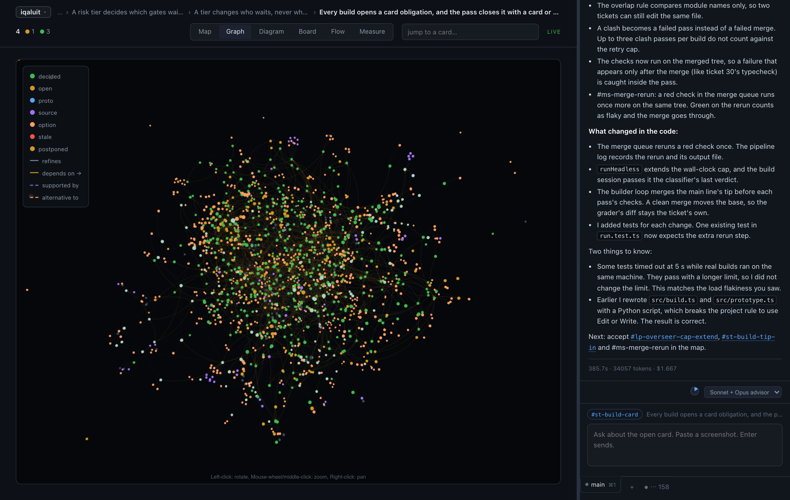

# werk

A visual layer over Claude Code. The map is the record of what the conversation settled.

When you design software with an agent, the decisions live in a chat transcript that
nobody reads twice. werk keeps them in a **map**: cards for decisions and open questions,
joined by typed links. The agent writes to the map in the same turn the decision is made.
When a decision changes, every card that rested on it turns **stale**. Nothing is deleted.

## The idea

1. **The log is the truth.** Every change is an event in an append-only file.
2. **The graph is derived.** Fold the log and you get cards and links. Delete the graph and it rebuilds.
3. **The agent proposes, the person accepts.** A new card is a ghost until the person accepts it. In the build phase the agent keeps proposing, and the build does not wait.
4. **Links carry meaning.** `refines` is where a card sits. `depends_on` is what it needs. When a target is reopened, its dependents go stale.
5. **Rejected options stay.** An alternative that was weighed and dropped is kept, with the reason.

## Two phases

**Plan** is about getting alignment. The person talks with Claude and the agent builds
prototypes to answer questions that talk cannot settle. Decisions land on the map as cards,
and the person accepts them.

**Build** is about letting Claude work on its own. It takes the decided cards, turns them
into tickets and writes production code, in isolated branches and behind checks. It does not
wait for the human. When a build learns something the map does not say, Claude proposes
changes to the map. The person reviews those proposals when ready: the build is never blocked on them.

The board shows tickets moving through the build phase.

## Branches

| Branch | What it is |
| --- | --- |
| [`prototype`](../../tree/prototype) | The prototype. It is what it is: it was made iteratively and interactively, in conversation with Claude Code, with the tool used on itself while it was built. Rough, fast, and not meant to be maintained. It includes the full `.werk` directory: the decision map, plans, held-out sets and pipeline records that the conversation produced. |
| [`v0`](../../tree/v0) | The version that the prototype builds **autonomously**. The prototype holds the decisions and the tickets. Its pipeline plans, builds and checks the code of `v0`, one ticket at a time. The commit history of `v0` is the trace of those builds. |

To see the idea working, start with `prototype`: run `node src/cli.ts serve` (needs Bun)
and open the map. To see the tool built by the tool, read `v0`.

## Status

Experimental. Neither branch is a supported product.
